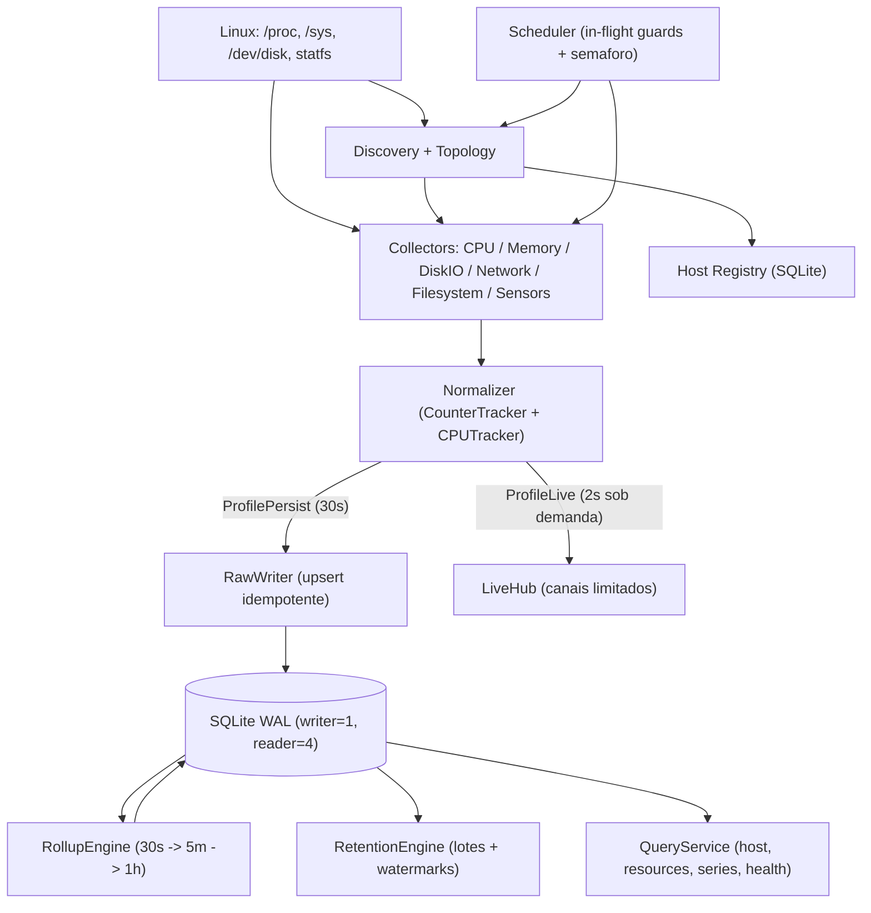

# Resumo da Implementação — Vektor v0.1

**Status:** Implementado. Validação local concluída e aceite no Ubuntu Server 26.04.1 LTS confirmado pelo responsável pelo projeto.

**Base técnica:** [`TECHNICAL_DESIGN_V0.1.md`](TECHNICAL_DESIGN_V0.1.md) e [`project-context.md`](project-context.md)

**Linguagem e persistência:** Go (`go 1.26.0` no `go.mod`, zero CGO) + SQLite WAL via `modernc.org/sqlite v1.62.0`

---

## 1. Visão geral e escopo entregue

A v0.1 implementa a fundação completa do **Metrics Engine** e do **History Engine** do Vektor dentro de um único processo Go não privilegiado (`vektord`, em `cmd/vektord/`).

### Incluído na v0.1
- Coleta nativa Linux diretamente via `/proc`, `/sys` e `syscall.Statfs` (sem `exec.Command` e sem privilégios de `root`).
- CPU total e por core (`/proc/stat`), load average (`/proc/loadavg`), RAM e swap (`/proc/meminfo`), I/O de blocos incluindo LVM/Device Mapper (`/proc/diskstats`), tráfego/erros/drops por NIC e agregado do host (`/proc/net/dev`), uso de filesystems locais (`/proc/self/mountinfo` + `statfs`) e sensores térmicos (`/sys/class/hwmon`).
- Descoberta dinâmica e reconciliação persistente de recursos (`host`, `cpu_core`, `disk`, `filesystem`, `nic`, `sensor`) preservando histórico após remoções.
- Derivação de taxas com relógio monotônico, perfis independentes (`persist` vs `live`), detecção de reset/wrap 32-bit plausível e reset automático de baselines por mudança de `boot_id`.
- Persistência transacional idempotente em SQLite WAL (`30s`), rollups ponderados (`30s -> 5m -> 1h`), retenção protegida por watermarks (`24h / 7d / 90d`), backup consistente via `VACUUM INTO`, serviço de consulta histórica (`QueryService`), `LiveHub` sob demanda e binário `vektord` com modo diagnóstico `--check`.

### Fora do escopo da v0.1 (etapas seguintes)
- Endpoints HTTP REST/SSE, autenticação, sistema de alertas, frontend React/TypeScript, controle de serviços `systemd`, containers/VMs (Docker/LXC/libvirt) e empacotamento `.deb`.

---

## 2. Arquitetura e estrutura de pacotes

| Pacote / Caminho | Responsabilidade principal |
|---|---|
| `cmd/vektord/main.go` | Entrypoint do daemon, flags/env `VEKTOR_*`, `--check` e shutdown gracioso (`SIGINT`/`SIGTERM`). |
| `internal/config/` | Configurações padrão, política de exclusão de filesystems e validação de limites (`config.go`). |
| `internal/metrics/` | Tipos base (`RawSample`, `CPUSample`, `MetricPoint`, `Clock`) e catálogo versionado `v1` (`types.go`, `catalog.go`). |
| `internal/metrics/collector/` | Coletores `/proc`, `/sys`, `statfs`, cache com idade e descoberta dinâmica (`discovery.go`, `cpu.go`, `memory.go`, `disk_io.go`, `network.go`, `filesystem.go`, `sensors.go`). |
| `internal/metrics/tracker/` | Cálculo de taxas e percentuais por perfil, wrap 32-bit, reset de `boot_id` e agregação de rede do host (`counter.go`, `cpu.go`, `normalizer.go`). |
| `internal/metrics/scheduler/` | Coordenação dos loops periódicos/sob demanda, `in_flight` guards e fan-out não bloqueante (`scheduler.go`, `live_hub.go`). |
| `internal/database/` | Pools separados de escrita (`MaxOpenConns=1`) e leitura (`MaxOpenConns=4`, `query_only=1`), migrations, `QuickCheck`, `Optimize`, `Checkpoint` e `Backup` (`database.go`). |
| `internal/host/` | Inventário estático do host e reconciliação persistente de recursos (`inventory.go`, `registry.go`). |
| `internal/history/` | `RawWriter`, `RollupEngine`, `RetentionEngine`, `MaintenanceRunner` e `QueryService` (`writer.go`, `rollup.go`, `retention.go`, `query.go`). |
| `internal/observability/` | Logger JSON (`slog`) e `HealthTracker` thread-safe (`logger.go`, `health.go`). |
| `migrations/` | Schema SQLite `STRICT` + `WITHOUT ROWID` embarcado via `embed.FS` (`001_initial_schema.sql`). |
| `docs/adr/` | Registros de decisão arquitetural (`ADR-001` a `ADR-003`). |
| `tests/integration/` | Pipeline completo ponta a ponta (`pipeline_test.go`) e benchmark de 24h (`benchmark_test.go`). |

---

## 3. Decisões arquiteturais (ADRs)

- **[ADR-001](docs/adr/ADR-001-process-and-sqlite-architecture.md) — Processo único e SQLite:** Adoção do binário `cmd/vektord/` usando `modernc.org/sqlite` (zero CGO), pools separados (`writer=1`, `reader=4` em `mode=ro`), `PRAGMA synchronous=NORMAL` como padrão (configurável para `FULL`) e snapshots consistentes via `VACUUM INTO`.
- **[ADR-002](docs/adr/ADR-002-storage-schema-and-metrics-catalog.md) — Schema EAV, catálogo e cobertura:** Adoção de `metric_buckets` (`STRICT, WITHOUT ROWID`) validada em benchmark de 24h; chaves fixas no catálogo central `v1`; persistência de `cpu.core.busy_pct` e `sensor.temperature_celsius` em todos os tiers (com flags de desativação); cobertura nominal explícita (`sample_count / expected_samples`) e média amostral sem interpolação de lacunas.
- **[ADR-003](docs/adr/ADR-003-resource-identity-and-network-aggregation.md) — Identidade de recursos e rede:** Chaves externas hierárquicas (`dm:<uuid>`, `wwid`, `serial`, `uuid:<uuid>:<mount>`, `pci:<addr>`, `mac:<mac>`, `virtual:<name>`, `hwmon:<chip>:<dev>:<channel>`), retenção de recursos removidos com `active=0`, inventário completo de NICs virtuais e soma do agregado do host apenas para NICs físicas não escravas de bond + masters de bond (evitando dupla contagem em bridges/veth/slaves).

---

## 4. Detalhes técnicos por componente

### 4.1 Configuração e catálogo de métricas
- `internal/config/config.go` aplica intervalos iniciais (`30s` persistência, `2s` live, `60s` descoberta/FS lento, `10s` sensores, `5m` rollup, `60s` grace) e rejeita intervalos agressivos ou retenções inconsistentes (`MediumRetention < RawRetention`, etc.).
- `internal/metrics/catalog.go` registra todas as métricas aceitas no banco (CPU host/core, load, memória/swap, disco I/O, filesystem, rede por NIC e agregado host, sensores) e fornece `AlignBucketMs` em UTC.

### 4.2 Coletores Linux e descoberta dinâmica
- Todos os coletores aceitam caminhos raiz injetáveis (`ProcRoot`, `SysRoot`, `EtcRoot`, `DevDiskRoot`) e `Clock` injetável, permitindo testes determinísticos com fixtures sintéticas e execução direta no kernel real.
- `Discovery` (`internal/metrics/collector/discovery.go`) ignora dispositivos efêmeros (`loop*`, `ram*`, `zram*`, `sr*`, `fd*`), faz unescape octal em `mountinfo` (ex.: `\040`), exclui pseudo/remote/FUSE (`tmpfs`, `proc`, `nfs*`, `cifs`, `fuse.*`, etc.) e deduplica bind mounts por `(major:minor, root)` preservando o mountpoint mais curto.
- `FilesystemCollector` e `SensorCollector` usam guarda `in_flight` por alvo e semáforos limitados (`2` workers), garantindo que um mount travado em syscall no kernel ou sensor sem permissão não bloqueie outros alvos nem gere crescimento de goroutines. Leituras em cache preservam seu timestamp real de observação (`ObservedAt`).

### 4.3 `CounterTracker`, `CPUTracker` e `Normalizer`
- **Primeira leitura nunca gera taxa falsa:** a primeira observação armazena apenas a baseline; apenas deltas válidos subsequentes emitem `MetricPoint`.
- **Relógio monotônico:** cálculo de `delta / elapsed.Seconds()` usa `Monotonic()` para não produzir taxas negativas ou picos em saltos de horário NTP (`wall_clock_jump` gera warning estruturado e incrementa contador de saúde).
- **Resets, wraps e reboots:** valores decrescentes são tratados como reset (descarta um intervalo e reinicializa baseline), aplicando wrap de 32 bits apenas quando `CounterBits == 32` e há evidência plausível (`prev >= 0x80000000` e `curr < 0x80000000`). Alterações em `boot_id` invalidam todas as baselines em ambos os perfis.
- **Perfis independentes:** `ProfilePersist` e `ProfileLive` mantêm estado separado; desconectar o último assinante live chama `ClearProfile(ProfileLive)` sem afetar o loop de persistência.

### 4.4 Scheduler e `LiveHub`
- `Scheduler` (`internal/metrics/scheduler/scheduler.go`) coordena os loops de descoberta, persistência, FS lento, sensores, manutenção (`Rollup -> Retention`) e live sob demanda.
- Cada coletor rápido possui guarda `in_flight` e timeout por ciclo (`CollectorTimeout`): caso um coletor bloqueie em chamada de sistema, os demais coletores seguem atualizando e nenhuma goroutine adicional é criada nos ciclos seguintes.
- `LiveHub` (`internal/metrics/scheduler/live_hub.go`) entrega `LiveSnapshot` em canais com buffer limitado (`4`), descartando eventos antigos para consumidores lentos (`dropped_live_events`) e ativando o loop de `2s` apenas enquanto `SubscriberCount() > 0`.

### 4.5 SQLite WAL, Writer, Rollups, Retenção e Query
- **Migrations e schema:** `001_initial_schema.sql` cria `resources`, `metric_buckets`, `rollup_state` e `system_meta`. `002_rollup_repairs.sql` cria `rollup_dirty` e protege agregados legados cuja fonte possa estar incompleta.
- **`RawWriter` (`internal/history/writer.go`):** grava lotes e marca correções pendentes em uma transação. O upsert é idempotente, reenvios expirados são rejeitados e erros `SQLITE_BUSY`/`SQLITE_LOCKED` têm até três tentativas.
- **`RollupEngine` (`internal/history/rollup.go`):** agrega `30s -> 300s` e depois `300s -> 3600s` em janelas fechadas após `RollupGrace` (`60s`), garantindo que `1h` nunca avance à frente do watermark de `5m`.
  - *Otimização identificada no benchmark de 24h:* a versão inicial com `JOIN ranked` (`ROW_NUMBER()`) levava SQLite a executar varredura cartesiana O(N²) entre `agg` e `ranked` (>600s para 138 mil linhas). A substituição por uma CTE `agg` única com subquery escalar correlacionada na PK clusterizada `(resource_id, metric_key, resolution_s, bucket_start_ms)` (`WHERE 1 ON CONFLICT`) reduziu o rollup de 24h para **~452 ms** mantendo semântica idêntica para `value_last`.
- **`RetentionEngine` (`internal/history/retention.go`):** calcula cortes por tier sempre limitados por `rollup_state[300]` e `rollup_state[3600]` (nunca apaga dado bruto ou de 5m não consolidado) e executa remoção em lotes indexados de até 5.000 linhas.
- **`QueryService` (`internal/history/query.go`):** implementa `GetHost`, `ListResources`, `QuerySeries` e `GetHealth`. No modo `step="auto"`, seleciona a resolução mais fina que respeite `MaxPoints` (padrão `600`, máximo `2000`) sem fingir cobertura de `30s` quando o início do intervalo já expirou para tiers mais grossos.

---

## 5. Cobertura dos critérios obrigatórios (Seção 10 do Design)

| Critério da Seção 10 | Teste(s) implementado(s) |
|---|---|
| Counter: primeira coleta sem taxa falsa | `TestCounterFirstCollectionProducesNoRate`, `TestEndToEndPipelineRollupQueryBackupAndReboot` |
| Counter: reset, wrap 32-bit, reboot (`boot_id`) e NTP | `TestCounterResetAndWrap32Bit`, `TestCounterLarge64BitPrecisionAbove2Pow53`, `TestNTPBackwardWallJumpUsesMonotonicClock` |
| Counter: perfis `live` e `persist` independentes | `TestProfilesIndependentAndBootIDReset`, `TestLiveHubOnDemandZeroSQLiteWritesAndSlowSubscriberDrop` |
| Scheduler: coletor bloqueado sem travar irmãos nem vazar goroutines | `TestBlockedCollectorDoesNotStallSiblingsOrLeakGoroutines`, `TestFilesystemCollectorStalledMountIsolationAndInFlightGuard` |
| Discovery: add/remove/re-add preserva `resource_id` e histórico | `TestRegistryReconcileAddRemoveReactivatePreservesIDAndHistory`, `TestDiscoveryAddRemoveReAddPreservesHistoryAndTopology` |
| Storage: retry de ciclo não duplica contagem | `TestRawWriterIdempotentRetryAndOrdering` |
| Rollup: 10×20 + 2×80 -> média 30 (não 50) | `TestRollupWeightedMathGapsPartialWindowsAndReplay` |
| Rollup: janelas parciais, lacunas, crash/replay idempotente | `TestRollupWeightedMathGapsPartialWindowsAndReplay`, `TestRollupRollbackCatchUpAndMultiDayChunking`, `TestRollup1hWaitsFor5mWatermarkAndHandlesSourceGap` |
| Retention: não apaga fontes antes do rollup | `TestRetentionNeverDeletesUnrolledDataAndBatchesSafely` |
| SQLite: WAL, FKs, `SQLITE_BUSY`, falha gravada em health e backup | `TestOpenMigrateConstraintsAndBackup`, `TestRawWriterTransientSQLiteBusyRetryAndDegradedHealthOnFailure` |
| Host: Ubuntu + LVM + bridges/bonds/veth + hwmon sem dupla contagem | `TestUbuntuLVMBridgesBondsSensorsDiscoveryAndNoNetDoubleCount`, `TestEndToEndPipelineRollupQueryBackupAndReboot` |
| Performance & footprint 24h | `TestBenchmark24hFootprint`, `BenchmarkStorageAndQuery24h` |

---

## 6. Resultados de verificação observados

### 6.1 Análise estática e testes unitários/integração
- **`go vet ./...`** e **`go test -race -v -count=1 ./internal/... ./tests/integration/...`**: **100% aprovados** em todos os 10 pacotes de teste (`internal/config`, `internal/database`, `internal/history`, `internal/host`, `internal/metrics`, `internal/metrics/collector`, `internal/metrics/scheduler`, `internal/metrics/tracker`, `internal/observability`, `tests/integration`).

### 6.2 Footprint e latências em 24h (`linux/amd64`, Intel Core i5-13420H)
- **Cenário `TestBenchmark24hFootprint` (sem `-race`, 48 séries × 2880 ticks = 153.216 linhas após rollups `5m` e `1h`):**
  - Escrita acumulada 24h: `1.402s` (`486.79 µs`/lote em média)
  - Rollup completo de 24h (`30s -> 5m -> 1h`): `452.33 ms`
  - Consulta `1h` (`30s`): `293.60 µs` | Consulta `24h` (`auto` -> `300s`): `363.82 µs`
  - Tamanho em disco: `.db` = `24.281.088` bytes (`23.16 MiB`), `-wal` = `6.031.712` bytes, `-shm` = `32.768` bytes
- **Microbenchmarks `BenchmarkStorageAndQuery24h` (`go test -bench=. -benchmem`):**
  - `WriteBatch48Series`: `505.175 ns/op` (`~0.51 ms`), `28.765 B/op`, `735 allocs/op`
  - `Query1hRaw`: `144.154 ns/op` (`~0.14 ms`), `28.072 B/op`, `1000 allocs/op`
  - `Query24hAuto`: `410.119 ns/op` (`~0.41 ms`), `94.170 B/op`, `2409 allocs/op`
  - `Query7dHourly`: `47.346 ns/op` (`~0.05 ms`), `7.352 B/op`, `232 allocs/op`

### 6.3 Smoke test real do daemon (`vektord --check`)
Executado sem privilégios no host Linux local: descobriu `host=1`, `cpu_core=12`, `disk=1` (`nvme0n1`), `filesystem=22`, `nic=3` e `sensor=14`, encerrando com `status="ok"`, `db_ok=true`, `db_ping_ok=true` e `collector_error_count=0`.

### 6.4 Validação de encerramento da v0.1

- **Ambiente observado:** CachyOS Linux, kernel `6.18.60-2-cachyos-lts`, `x86_64`. `go vet ./...` e `go test -race -count=1 ./...` passaram. `vektord --check`, executado sem root e com SQLite temporário, retornou `status=ok`, `db_ping_ok=true`, gravação confirmada e zero erros de coleta. Um segundo processo encerrou com código 0 ao receber `SIGTERM`.
- **Relógio:** fixtures confirmaram boot adiantado, boot atrás do histórico, salto antes da primeira gravação nos dois sentidos e retomada automática após sincronização estável. Nenhum teste alterou a hora do host. O critério está na [seção 7.5 do design](TECHNICAL_DESIGN_V0.1.md#75-confiança-no-relógio-utc).
- **I/O:** filesystem simulado por função bloqueada e sensor por leitura de FIFO real. Outros coletores avançaram e o scheduler retornou em menos de um segundo após cancelamento, com os dois bloqueios ainda ativos. FIFO não reproduz estado D.
- **Histórico:** seis `SIGKILL` reais em subprocessos SQLite sobre bancos temporários. Após restart, `PRAGMA quick_check`, replay, média 50 com duas amostras, cobertura `2/10` e `2/120`, retenção e rejeição de reenvio expirado passaram. O teste verifica crash de processo com WAL, sem simular perda de energia.
- **Aceite de plataforma:** o responsável pelo projeto confirmou a validação no Ubuntu Server 26.04.1 LTS. Os resultados detalhados acima foram obtidos no CachyOS com as fixtures indicadas. [Roteiro no design](TECHNICAL_DESIGN_V0.1.md#aceite-manual-no-ubuntu-server-26041-lts)

---

## 7. Histórico de iterações no Git

| Commit | Escopo |
|---|---|
| `74eeeb7` | `feat: initialize vektor repo, config, metrics catalog, observability, and ADRs` |
| `f7d26e8` | `feat(metrics): add CounterTracker and core Linux procfs collectors` |
| `040b2bd` | `feat(storage): add SQLite WAL store, migrations, resource registry, and idempotent raw writer` |
| `e7551bf` | `feat(history): implement weighted idempotent rollups and safe retention engine` |
| `73c4b8c` | `feat(engine): add Linux discovery, filesystem/sensor collectors, scheduler, and live hub` |
| `6d24cb4` | `feat(query,cmd): add history query service, vektord daemon, integration suite, benchmarks, and rollup plan fix` |

---

## 8. Próximos passos (v0.2+)

1. Expor a camada HTTP (`GET /api/v1/host`, `/resources`, `/metrics`, `/health` e SSE `GET /api/v1/stream/live` conectado ao `LiveHub` e `QueryService`) com autenticação administrativa.
2. Implementar motor de alertas sobre séries normalizadas e notificações.
3. Desenvolver frontend React + TypeScript exibindo lacunas reais (`null`) sem interpolação.
4. Empacotar `vektord` com unit `systemd` (usuário dedicado `homelab` e hardening compatível com `/proc` e `/sys`) e pacote `.deb` para Ubuntu Server 26.04 LTS.
