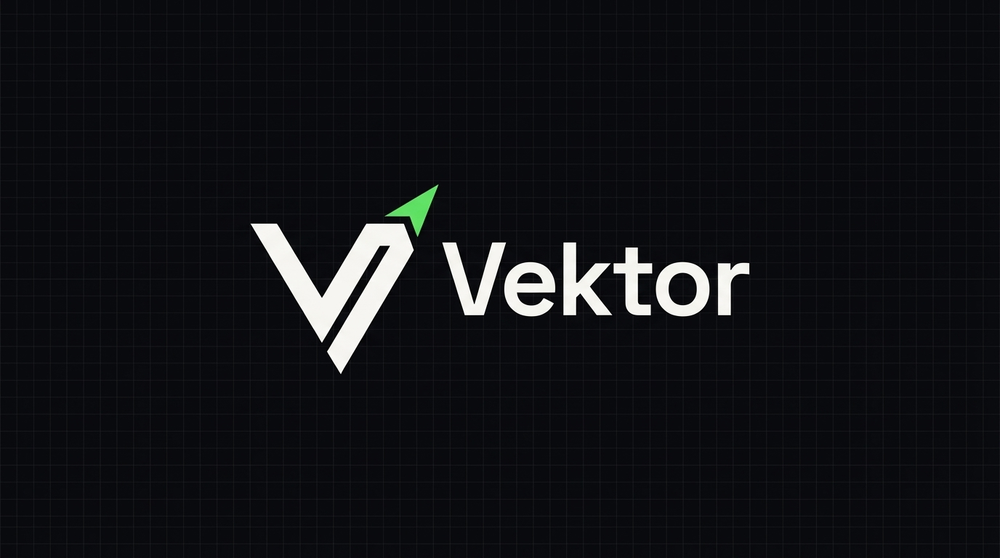

<p align="center">
  
</p>

# Vektor

**Vektor** is a lightweight, native Linux control plane that unifies **host monitoring**, **system operations**, and **Incus virtualization** in a single web interface.

It ships as a static Go binary (`vektord`) with an embedded UI and SQLite storage — no external database, no Prometheus/Grafana stack, and no YAML sprawl — paired with a minimal socket-activated helper (`vektor-ctl`) for privileged actions.

## Key Features

- **Real-time Monitoring & History:** Native Linux telemetry from `/proc`, `/sys`, and `statfs` streamed over SSE, with multi-resolution SQLite WAL history (`15m` to `30d`), temperature sensors, and webhook alerts.
- **Host Operations:** Inspect live processes, manage `systemd` services, read filtered `journald` logs in the browser, run controlled power actions, and review every action in a persistent audit log.
- **Actionable Diagnostics:** Built-in health checks (`vektord doctor` and UI diagnostics drawer) detect clock drift, permission issues, or daemon failures with copyable fix commands and inline logs.
- **Incus Virtualization:** Create and manage VMs, system containers, and OCI apps with per-instance historical metrics, port forwarding (`proxy` devices), environment variables, embedded command terminal, boot console, snapshots, and downloadable `.tar.gz` backups.
- **Least-Privilege Security:** `vektord` always runs unprivileged (`vektor` user). Privileged operations cross a Unix socket (`vektor-ctl.socket`) protected by kernel `SO_PEERCRED` verification and a closed allowlist ([ADR-006](docs/adr/ADR-006-privilege-separation-and-host-management.md)).

## Virtualization Types

When [Incus](https://linuxcontainers.org/incus/) is installed on the host, Vektor automatically detects it and lets you run three workload types side by side:

| Type | Engine | Best for |
| --- | --- | --- |
| **System Containers (`CT`)** | LXC | Full Linux environments with `systemd`, near-native performance, and low memory overhead |
| **App Containers (`OCI`)** | Incus OCI | Running Docker Hub / GHCR images (`nginx`, `caddy`, `redis`, etc.) with port forwarding and env vars — no Compose/YAML |
| **Virtual Machines (`VM`)** | KVM / QEMU | Full hardware & kernel isolation for independent operating systems or untrusted workloads |

> Incus is optional. Without it, all host monitoring, services, logs, processes, and alerting features work out of the box.

## Installation (Debian / Ubuntu)

Download the latest `.deb` package from [GitHub Releases](https://github.com/patricks-js/vektor/releases):

```bash
sudo dpkg -i vektor_<version>_amd64.deb
sudo -u vektor /usr/bin/vektord bootstrap-admin --data-dir /var/lib/vektor
sudo systemctl enable --now vektord
```

Open `http://<your-server>:8080` to sign in. Run `vektord doctor` anytime to verify collectors, SQLite, `vektor-ctl.socket`, and Incus connectivity.

<details>
<summary>What the package installs</summary>

- Binaries: `/usr/bin/vektord` and `/usr/bin/vektor-ctl`
- System user: `vektor` (member of `systemd-journal`)
- Units: `vektord.service`, `vektor-ctl.socket` (`/run/vektor/ctl.sock`), and `vektor-ctl.service`
- Data & config: `/var/lib/vektor/vektor.db` and `/etc/vektor/vektord.env`

</details>

### Changing the Web Port

By default, `vektord` listens on `127.0.0.1:8080`. To change the port (or bind to all interfaces), edit `/etc/vektor/vektord.env` and restart the service:

```bash
# /etc/vektor/vektord.env
VEKTOR_HTTP_ADDR=0.0.0.0:9090
```

```bash
sudo systemctl restart vektord
```

When running `vektord` directly, you can also pass `--http-addr` (e.g. `vektord --http-addr :9090`). If exposing Vektor on a LAN IP or behind a reverse proxy, set `VEKTOR_PUBLIC_ORIGIN` in `/etc/vektor/vektord.env` as well.

## Upgrade

Check for new releases and upgrade in place (verifies `SHA256SUMS.txt`, backs up `vektor.db`, and applies the update automatically):

```bash
vektord upgrade --check
sudo vektord upgrade
```

## Try the UI (Demo Mode)

Preview the full dashboard — including host operations and Incus VMs/containers — locally with realistic mock data and no backend daemon:

```bash
bun install --cwd web --frozen-lockfile
bun run --cwd web dev:demo
```

## Documentation

- [Changelog](CHANGELOG.md) — release history
- [Development & Build Guide](docs/DEVELOPMENT.md) — building from source, testing, SemVer, and releasing
- [OpenAPI Spec](docs/openapi-v1.yaml) · [API Guide](docs/API_V0.2.md) · [Design System](docs/WEB_DESIGN_SYSTEM.md)
- [Architecture Decision Records (`docs/adr/`)](docs/adr/) — SQLite storage, metrics catalog, SSE streaming, auth, and privilege separation
