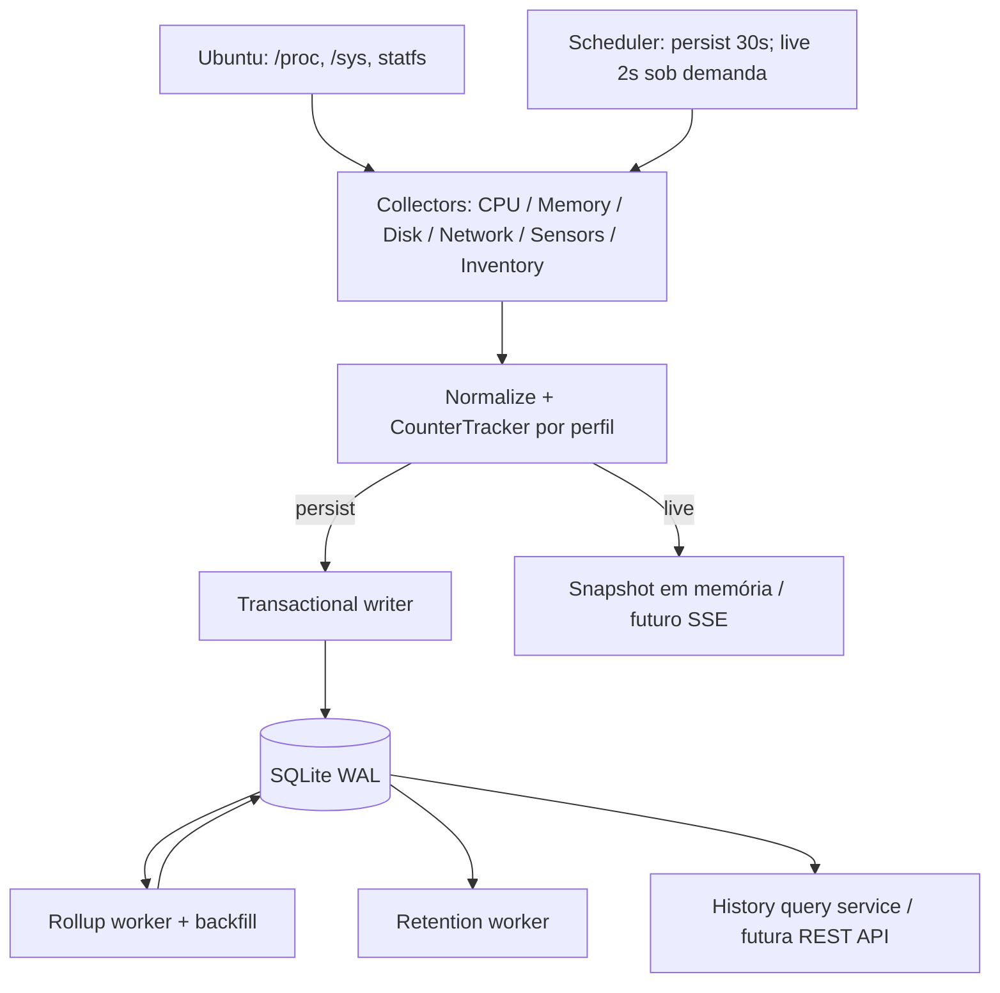

# Technical Design v0.1 — Metrics Engine & History Engine

**Estado:** Proposta para implementação (revisão 1)  
**Plataforma:** Ubuntu Server 26.04 LTS (`amd64` inicialmente; `arm64` após validação)  
**Escopo:** monitoramento local do host; sem gerenciamento de VMs/containers nesta versão  
**Referência de estudo:** `BESZEL-TECHNICAL-RESEARCH.md`, Beszel commit `82a8fe60` (conclusões de análise estática, não contrato de implementação)

## 1. Objetivo e limites

Implementar uma fundação de métricas de host Linux com baixo overhead, coleta robusta, séries temporais corretas, retenção previsível e recuperação após reinicialização. O backend é um **único processo Go não privilegiado**, com módulos internos desacoplados por interfaces Go. REST, SSE, autenticação, dashboard e alertas integram etapas posteriores; esta especificação define as saídas necessárias para eles.

**Incluído na fundação:** CPU total/por core, load average, RAM/swap, uso de filesystem local, I/O de disco, tráfego por interface, inventário de dispositivos e sensores suportados; coleta, derivação de taxas, armazenamento e consultas de histórico.

**Fora da fundação:** Docker/LXC, libvirt, SMART avançado, ZFS/Btrfs específicos, controle de systemd, operação privilegiada, monitoramento remoto, Prometheus/InfluxDB, mecanismos genéricos de plugins, alertas e backups de workloads.

### Princípios não negociáveis
1. Nenhum coletor lento deve impedir CPU/memória/rede de atualizar.
2. A primeira leitura de um contador nunca produz taxa fictícia.
3. Ausência de dados **não equivale a zero**.
4. Agregações são idempotentes e ponderadas pelas quantidades subjacentes.
5. Uma janela incompleta permanece visível como incompleta; não é descartada silenciosamente.
6. O processo não necessita de root e não expõe comandos arbitrários do SO.
7. O estado histórico sobrevive a `SIGTERM`, reinício e atualização do pacote.

## 2. Arquitetura interna



Pacotes sugeridos:

```text
cmd/homelabd/
internal/config/             # Defaults, limites, validação
internal/metrics/types.go    # Tipos, catálogo de métricas, unidades
internal/metrics/collector/  # Coletores e descoberta Linux
internal/metrics/tracker/    # Counters, baselines e resets
internal/metrics/scheduler/  # Loops e coordenação
internal/history/            # Writer, queries, rollups, retenção
internal/database/           # Abertura, migrations, lifecycle
internal/host/               # Inventário e IDs de recursos
internal/observability/      # Logs e health internos
migrations/
tests/integration/
```

Não há dois processos nem protocolo IPC na v0.1. A futura separação de operações privilegiadas ocorre por um helper independente, **sem transferir o monitoramento para ele por padrão**.

## 3. Contratos de domínio

```go
type Profile string
const (
    ProfilePersist Profile = "persist"
    ProfileLive    Profile = "live"
)

type MetricKind string
const (
    Gauge   MetricKind = "gauge"
    Counter MetricKind = "counter"
)

type RawMetric struct {
    ResourceID string      // ID persistente interno; host tem ID fixo
    Key        string      // Ex.: cpu.busy_pct, net.rx_bytes_total
    Kind       MetricKind
    Value      float64     // métricas convertidas: valores finitos; inteiros de bytes mantidos no raw conforme possível
    Time       time.Time   // momento efetivo da leitura
}

type RawSnapshot struct {
    CollectedAt time.Time
    Metrics     []RawMetric
    Warnings    []error
}

type Collector interface {
    Name() string
    Collect(ctx context.Context) (RawSnapshot, error)
}

type MetricPoint struct {
    ResourceID string
    Key        string
    Timestamp  int64   // Unix ms UTC
    Value      float64
    Valid      bool    // false => não persistir valor numérico, registrar lacuna via ausência
}
```

**Recomendação:** usar tipos específicos `uint64` para *counters brutos* quando possível e só converter para `float64` ao calcular taxa/resultado. Evita perda de precisão em contadores acumulados acima de `2^53`. `RawMetric` acima ilustra apenas a fronteira de alto nível e deve ser refinado para `RawGauge`/`RawCounter` discriminados na implementação.

**Catálogo central de métricas** define: chave, unidade canônica, recurso aplicável, modalidade (`gauge`, `rate`, `counter` de inventário), coleta habilitada e agregadores permitidos. Exemplos: `cpu.busy_pct` (%); `memory.used_bytes` (bytes); `disk.read_bytes_per_sec` (bytes/s); `net.rx_bytes_per_sec` (bytes/s); `filesystem.used_bytes` (bytes); `sensor.temperature_celsius` (°C). Nomes e unidades são estáveis e versionados. Coletor nunca escolhe labels arbitrárias de alta cardinalidade.

## 4. Coleta e processamento

### 4.1 Frequências padrão (configuráveis dentro de limites)

| Perfil | Dados | Frequência inicial | Comportamento |
|---|---|---:|---|
| Persistência | CPU/load/RAM/counters disco/rede | 30 s | Ciclo periódico sempre ativo |
| Ao vivo | CPU/load/RAM/counters disco/rede | 2 s | Apenas com assinantes; sem escrita em SQLite |
| Lento | Capacidade de filesystem | 60 s | Cache; NFS/CIFS/FUSE ignorados por padrão |
| Sensores | Temperatura | 10 s | Guard de in-flight por alvo; expõe último valor com idade |
| Descoberta | Discos, mounts, NICs e sensores | 60 s | Reconcilia adições, renomes e remoções |
| Inventário estático | OS/kernel/CPU/memória instalada | Boot e refresh manual | Cache e `updated_at` |

**Amostras de 30 segundos:** para gauge, registrar valor pontual no instante; para taxa, registrar a média observada durante o intervalo entre baselines válidos. Não denominar dados pontuais como média contínua de tempo sem justificativa.

### 4.2 Concorrência e timeouts

Scheduler com concorrência limitada (ex.: até 4 coletores rápidos). Cada coletor tem seu próprio timeout e guarda `in_flight` para impedir sobreposição. **Não usar mutex global** abrangendo chamadas de filesystem ou driver. `context.WithTimeout` só limita a espera de código que respeita cancelamento: syscalls bloqueadas no kernel podem continuar; usar por alvo *in-flight guard*, limites de goroutines e exclusão de mounts remotos por padrão. Não criar goroutines ilimitadas como estratégia de timeout.

Uma falha parcial gera log estruturado e omite as métricas afetadas, mas não invalida todo o ciclo. A última amostra pode ser exibida na UI como *stale*, nunca como atual sem marcação.

### 4.3 CounterTracker

Chave: `(profile, resource_id, metric_key)`; estado `prev_uint64`, `prev_monotonic_time`, `last_seen`, `boot_id`. Primeiro ponto: salvar baseline e retornar `no_value`. Para contador crescente: `delta = current - previous`; taxa = `delta / elapsed.Seconds()`. Para `current < previous`, identificar reset/recriação e **descartar um intervalo**, reinicializando baseline. Wrap 32-bit é tratado *somente* para campos Linux documentadamente sujeitos a esse wrap e quando há evidências plausíveis; não supor wrap para counters genéricos. Tempo decorrido `<= 0`: descartar. Mudança de `boot_id`: invalidar todos os baselines. Baselines live e persist são independentes e os live são descartados ao fechar última sessão. Evict de recursos ausentes após janela configurada.

Propriedade: **nunca usar clamp de taxa arbitrário como mecanismo principal de correção de overflow**. Validar plausibilidade apenas com metadados reais, quando disponíveis, e sinalizar anomalia.

### 4.4 Identidade e descoberta

Um `resource_id` interno persistente é associado à melhor identidade de origem disponível (p.ex. filesystem UUID + mountpoint, NIC por ifindex durante o boot com metadados de MAC/pci, sensor por caminho hwmon/label), reconhecendo que nenhum identificador é universalmente estável. Não usar apenas `sda`, `eth0` ou nome do container. Registrar `first_seen`, `last_seen`, `active`, `external_key` e metadados. Recursos inativos mantêm histórico; reaparecimento é reconciliado somente quando identidade corresponde com confiança. **NICs virtuais são inventariadas**, não apagadas; totals agregados de rede têm regra explícita para evitar dupla contagem em bridges/bonds.

## 5. Esquema SQLite v1 (proposta)

Armazenar **uma linha por amostra de métrica escalar** simplifica inclusão de novas métricas com baixo custo de manutenção no single-node. A cardinalidade deve ser medida antes de congelar a decisão. Histórico e rollups usam o mesmo formato.

```sql
PRAGMA foreign_keys = ON;
PRAGMA journal_mode = WAL;
PRAGMA busy_timeout = 5000;
-- synchronous=NORMAL é opção de performance, não promessa de durabilidade em power loss.

CREATE TABLE resources (
  id TEXT PRIMARY KEY,
  kind TEXT NOT NULL,
  external_key TEXT NOT NULL,
  display_name TEXT NOT NULL,
  metadata_json TEXT NOT NULL DEFAULT '{}',
  active INTEGER NOT NULL DEFAULT 1 CHECK (active IN (0,1)),
  first_seen_ms INTEGER NOT NULL,
  last_seen_ms INTEGER NOT NULL,
  UNIQUE(kind, external_key)
) STRICT;

CREATE TABLE metric_buckets (
  resource_id TEXT NOT NULL REFERENCES resources(id),
  metric_key TEXT NOT NULL,
  resolution_s INTEGER NOT NULL CHECK (resolution_s IN (30,300,3600)),
  bucket_start_ms INTEGER NOT NULL,
  sample_count INTEGER NOT NULL CHECK (sample_count > 0),
  value_sum REAL NOT NULL,
  value_min REAL NOT NULL,
  value_max REAL NOT NULL,
  value_last REAL NOT NULL,
  last_sample_ms INTEGER NOT NULL,
  PRIMARY KEY (resource_id,metric_key,resolution_s,bucket_start_ms)
) STRICT, WITHOUT ROWID;

CREATE INDEX idx_metric_retention
 ON metric_buckets(resolution_s,bucket_start_ms);

CREATE TABLE rollup_state (
  resolution_s INTEGER PRIMARY KEY,
  closed_through_ms INTEGER NOT NULL
) STRICT;

CREATE TABLE system_meta (
  key TEXT PRIMARY KEY,
  value TEXT NOT NULL
) STRICT;
```

O recurso host recebe uma linha `resources(kind='host', external_key='local')`. Inventário detalhado pode morar em `metadata_json` do host inicialmente (com validação e limites), e migrar para uma tabela própria se necessário. `metric_key` deve existir no catálogo, não ser fornecido livremente pelo usuário. Migrations SQL versionadas e embarcadas desde o primeiro build.

**Detalhes de produção:** habilitar `foreign_keys` por conexão; inicialização WAL e suas opções são feitas no bootstrap do banco; escritores serializados; transações curtas; teste de integridade após crash; estratégia de backup com API de snapshot do SQLite ou cópia consistente (nunca cópia ingênua do `.db` em WAL ativo).

## 6. Semântica matemática das métricas históricas

Cada bucket guarda **`sum, count, min, max, last`** sobre observações válidas. Para amostras válidas com intervalos nominais equivalentes: `avg = sum / count`.

Para combinar buckets filhos: `sum_parent = Σsum_child`, `count_parent = Σcount_child`, `min_parent = min(min_child)`, `max_parent = max(max_child)`, `last_parent = value_last` do filho com `last_sample_ms` maior. **Nunca fazer `AVG(avg_child)`**.

`sample_count` permite calcular cobertura aproximada (`count / expected_samples`) por métrica; lacunas e janelas incompletas não são preenchidas com zero nem interpoladas. O frontend deve mostrar gaps. **A média definida aqui é média das amostras observadas, não média ponderada por duração**. Caso medições irregulares exijam média por tempo, evoluir o schema para `weighted_sum`/`weight_ms` e testar explicitamente a semântica; não misturar metodologias.

`gauge`, `rate` e estado de serviço têm semânticas diferentes. Estados categóricos ficam fora de `metric_buckets`, e counters brutos não são agregados por média como se fossem percentuais. Para totals de bytes trafegados, usar deltas acumulados separadamente em versão futura, não `sum(rate)` sem considerar duração.

### 6.1 Exemplo matemático

Uma janela com 10 observações de 20% e outra com 2 observações de 80% produz `(10*20 + 2*80)/12 = 30%`, não `(20+80)/2 = 50%`. Sem amostras, não gerar bucket.

## 7. Persistência, rollups e retenção

### 7.1 Escrita do nível raw

O loop persistente produz métricas válidas; agrupa cada `timestamp` em `bucket_start_ms = floor(ts / 30000) * 30000` (UTC). Escrever lote em uma transação, `INSERT ... ON CONFLICT ... DO UPDATE` seguro para repetição com **chave de ciclo idempotente**. **Atenção:** somar novamente `value_sum` em um retry duplica valores; para raw, usar uma amostra definitiva por `(resource,metric,bucket)` ou persistir IDs de amostras e garantir que o mesmo ciclo não seja contado duas vezes. MVP: **uma amostra válida por métrica/bucket de 30 s** via upsert de substituição (`sample_count=1`, `value_sum=value`). Timestamp efetivo determina bucket, e o scheduler evita ciclos simultâneos. Se houver duas leituras válidas no mesmo bucket, prevalece a mais recente em vez de acumular por acidente.

### 7.2 Rollups

Os buckets são UTC, com fronteiras inteiras: `5m=300s`, `1h=3600s`. A cada 5 minutos, processar **apenas janelas fechadas** (grace de 60 s para atrasos) e todas as janelas pendentes desde o watermark. Um `INSERT ... SELECT` com agregação dos filhos cria/atualiza o bucket pai; a transação grava bucket(s) e avanço do `rollup_state` conjuntamente. Usar `UPSERT` de substituição, nunca incremento cego. Uma janela sem filhos não gera ponto; uma janela parcialmente coberta gera bucket com count real. Reexecutar após crash mantém resultados idênticos.

**Condição essencial:** não remover fonte antes de consolidar buckets descendentes cuja retenção ainda exige a fonte. Para evitar lacunas em janela atrasada, processar `raw→5m` e `5m→1h` em ordem antes da limpeza. Definir estratégia para atraso maior que retenção raw: sinalizar dados irrecuperáveis, não criar dados inventados.

### 7.3 Retenção default

| Tier | Resolução | Retenção |
|---|---:|---:|
| raw | 30 s | 24 horas |
| medium | 5 min | 7 dias |
| long | 1 hora | 90 dias |

Retenção roda em lotes indexados, após rollups, e mantém o SQLite em limites observáveis. A janela de retenção deve ser aplicada por `(resolution_s, bucket_start_ms)`; schema e política dimensionados com benchmark, não estimativas assumidas. Inicialmente `auto_vacuum` e checkpointing serão configurados após ensaios de I/O; `PRAGMA optimize` em manutenção de baixa frequência, com cuidado para não bloquear consultas. Limites de disco e falha de escrita devem expor erro de saúde sem derrubar o servidor de monitoramento.

### 7.4 Falhas e recuperação

- **Crash antes do commit:** zero ou todos os pontos do lote são gravados.
- **Crash durante rollup:** transação faz rollback; watermark não avança.
- **Gap de coleta:** bucket faltante permanece ausente; o próximo válido segue normalmente.
- **Dispositivo removido:** marca `active=0`, preserva histórico até expirar.
- **Reboot:** `boot_id` novo reinicializa baselines e loops, rollups alcançam buckets pendentes.
- **Disco cheio/SQLite_BUSY:** registro estruturado, health `degraded`, retry com backoff limitado; não loop infinito de escrita.
- **Mudança de horário/NTP:** cálculo de taxa usa relógio monotônico; buckets usam UTC; saltos de wall clock geram lacunas/alertas de qualidade, nunca deltas negativos.

## 8. Contratos de consulta (para etapa REST posterior)

```text
GET /api/v1/host
GET /api/v1/resources?kind=nic|disk|filesystem|sensor
GET /api/v1/metrics?resource_id=...&key=cpu.busy_pct&from_ms=...&to_ms=...&step=auto
GET /api/v1/health
GET /api/v1/stream/live  (SSE, fase de API)
```

Resposta de série: `resource_id`, `metric_key`, `unit`, `resolution_s`, `from_ms`, `to_ms`, `points[{bucket_start_ms,avg,min,max,last,sample_count,coverage}]`. O backend escolhe um nível que mantenha quantidade de pontos limitada (ex.: até 600) e explica resolução real; consulta de ranges sem nível suficientemente fino **não** finge resolução superior. Autenticação e autorização obrigatórias quando expostos via HTTP. O dashboard deve interpretar `null`/ausência como lacuna.

O SSE de 2 s deve enviar snapshots efêmeros para vários assinantes por único loop sob demanda, sem persistir, com canal limitado por cliente, descarte de amostras antigas para clientes lentos e heartbeat. Não recomputar leitura por cliente.

## 9. Observabilidade, segurança e configuração

- Executável sob usuário dedicado `homelab`, sem root; aplicar hardening de systemd compatível com `/proc`, `/sys` e diretório de estado.
- Sem sockets Docker/libvirt acessíveis à API na v0.1.
- Logs estruturados com nome de coletor, duração, falha e contagem de amostras; sem dados pessoais nem segredos.
- Health interno: `last_collect_at`, `last_write_at`, `db_ok`, `rollup_lag_s`, `collector_error_count`, `dropped_live_events`.
- Configuração inicial: `persist_interval=30s`, `live_interval=2s`, `discovery_interval=60s`, `slow_fs_interval=60s`, limites de concorrência e timeout, diretório de dados, política de retenção; rejeitar valores perigosos ou absurdamente frequentes.
- Testar leitura em `Ubuntu Server 26.04 LTS` bare metal e VM, com root filesystem `ext4`/LVM; montagens remotas excluídas por padrão.

## 10. Testes obrigatórios e critérios de aceite

| Classe | Cenário | Aceite |
|---|---|---|
| Counter | Primeira coleta | Nenhuma taxa falsa |
| Counter | Reset, wrap 32-bit, reboot | Taxas não negativas e sem picos artificiais |
| Counter | Intercala live/persist | Baselines independentes |
| Scheduler | Coletor bloqueado | Outros coletores continuam e não há crescimento ilimitado de goroutines |
| Discovery | NIC/disco adicionado/removido | Reconciliação preserva histórico e não duplica recurso |
| Storage | Retry de um ciclo | Mesma amostra não é contada duas vezes |
| Rollup | 10 amostras a 20 + 2 a 80 | Média 30, não 50 |
| Rollup | Falta de amostras | Janela parcial persiste com contagem correta e gaps visíveis |
| Rollup | Crash e reinício | Catch-up idempotente; watermark consistente |
| Retention | Expiração por tier | Fontes necessárias não são apagadas prematuramente |
| SQLite | WAL, lock, disco cheio | Falhas registradas sem corrupção ou crash do serviço |
| Host | Ubuntu + LVM + NICs virtuais | Identificação e métricas coerentes; sem dupla contagem oculta |
| Performance | 24 h de execução | RSS, CPU, I/O, tamanho do banco e latência medidos e registrados |

**Metas provisórias (não verificadas):** CPU média em idle `<1%` de um core; RSS do processo `<100 MiB` em host pequeno; latência P95 de coleta rápida `<250 ms` em hardware de teste. Não tornar essas metas bloqueantes até definir máquina de referência. Benchmark deve registrar CPU, RAM, tamanho do SQLite/WAL, taxa de escrita, número de recursos e período de coleta.

## 11. Ordem de implementação

1. **PoC dos coletores e CounterTracker** (CPU/RAM/rede/disco; testes determinísticos de deltas e reboot).
2. **Schema SQLite + writer raw idempotente** (migrations, conexão, transações e recovery).
3. **Rollup engine + retenção** (fixtures com gaps, replays, períodos parciais e power-loss simulado).
4. **Descoberta dinâmica, sensores e limites de concorrência** (testes com LVM, bridges e recursos instáveis).
5. **Interface de consulta histórica + testes de benchmark** (ainda sem UI).
6. **REST/SSE, alertas, frontend e `.deb`** (conforme roadmap do projeto, fora do escopo detalhado deste documento).

## 12. Decisões pendentes antes de estabilizar o schema

- Confirmar por benchmark se modelo EAV (`metric_buckets`) tem footprint aceitável versus tabelas específicas de CPU/memória/disco/rede.
- Definir como medir e exibir cobertura (`expected_samples` pode ser incorreto com intervalos variáveis e interrupções).
- Definir identidade confiável de NIC/bond/bridge e regras de agregação de tráfego por host.
- Decidir se métricas por core e sensores entram em raw e em todos os tiers.
- Definir política de durabilidade SQLite (`FULL` vs `NORMAL`) e método de backup consistente.
- Verificar fontes de permissões de sensores e interação de hardening systemd com `/proc`/`/sys`.

**Critério de encerramento do design:** decisões acima registradas em ADRs curtas; testes matemáticos de rollup aprovados; benchmark do schema com dados representativos; implementação dos dois motores pode então começar sem ambiguidades substanciais.
