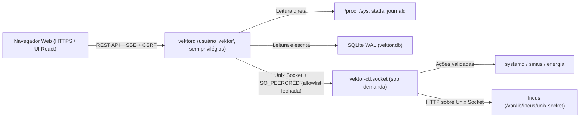
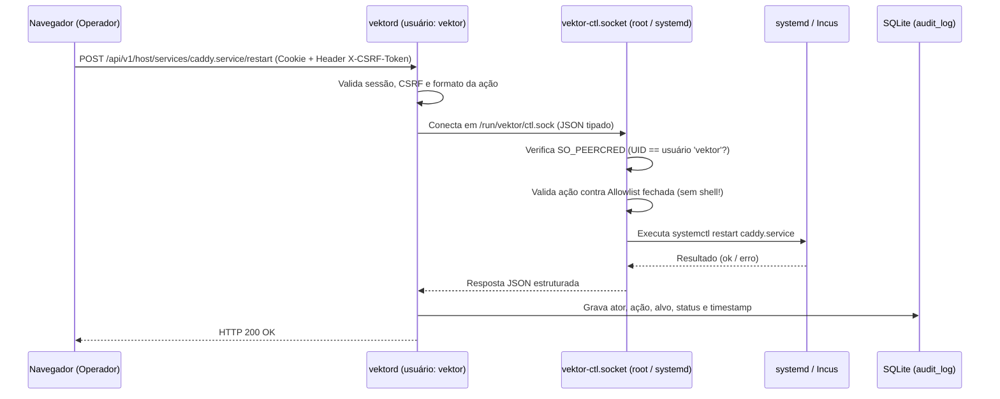

# Guia Completo do Vektor

Este guia explica **todas as funcionalidades do Vektor em profundidade** — não apenas o que cada tela faz, mas **como tudo funciona por baixo dos panos** no Linux. Ele foi escrito pensando em quem está começando no desenvolvimento de software de infraestrutura (DevOps, SRE ou backend) e quer entender de verdade os conceitos envolvidos.

---

## 1. O que é o Vektor e por que ele foi construído assim?

Quando você administra um servidor Linux em produção ou em um homelab, normalmente acaba montando um quebra-cabeça de ferramentas:

- **Prometheus + Node Exporter + Grafana** para ver gráficos de CPU, memória e disco;
- **SSH + `htop` + `systemctl` + `journalctl`** para investigar processos, reiniciar serviços e ler logs;
- **Docker / Portainer + ferramentas de VM** para rodar containers e máquinas virtuais.

O **Vektor** reúne tudo isso em **um único painel web nativo**, entregue por um binário estático em Go (`vektord`) com o frontend React embarcado dentro do próprio executável e um banco SQLite embutido. Não há banco externo para manter, nem agentes espalhados, nem pilhas de arquivos YAML.



> **Por que dois binários (`vektord` e `vektor-ctl`)?**
> Porque em software de infraestrutura existe uma regra de ouro: **a aplicação que fica ouvindo requisições web nunca deve rodar como `root`**. Veremos em detalhes na [Seção 6](#6-segurança-por-design-autenticação-csrf-e-separação-de-privilégios) como essa separação protege o servidor.

---

## 2. Monitoramento Nativo do Host (Telemetria do Kernel Linux)

Em vez de executar dezenas de comandos externos (`top`, `df`, `free`, `iostat`) a cada segundo — o que desperdiça CPU e cria processos o tempo todo — o Vektor lê os dados **diretamente dos arquivos virtuais que o kernel Linux mantém em memória**:

- **`/proc`** (*procfs*): expõe estatísticas de CPU (`/proc/stat`), carga média (`/proc/loadavg`), memória (`/proc/meminfo`), disco (`/proc/diskstats`), rede (`/proc/net/dev`) e processos ativos (`/proc/<pid>/...`).
- **`/sys`** (*sysfs*): expõe informações de hardware, placas de rede (`/sys/class/net`), dispositivos de bloco (`/sys/block`) e sensores de temperatura (`/sys/class/hwmon`).
- **`statfs` (syscall)**: consulta diretamente no kernel o espaço total, usado, livre e percentual de **inodes** de cada ponto de montagem (filesystem).

### Gauge vs. Counter (e por que o relógio monotônico importa)

Em observabilidade de sistemas, existem dois tipos fundamentais de métricas:

1. **Gauge (Medidor instantâneo):** representa um valor no exato instante da leitura — como *"57% de memória usada"* ou *"54 °C na CPU"*. Basta ler e exibir.
2. **Counter (Contador cumulativo):** o kernel Linux não guarda "quantos MB/s a placa de rede está trafegando agora"; ele guarda *"quantos bytes passaram pela placa desde que o servidor ligou"*. Para calcular a taxa (**Rate**, ex: `bytes/s`), o Vektor faz:
   $$\text{taxa} = \frac{\text{leitura atual} - \text{leitura anterior}}{\Delta t}$$

**O detalhe de infraestrutura:** para calcular $\Delta t$, o Vektor usa o **relógio monotônico** do sistema (um cronômetro interno que só anda para frente), e **não** a hora do relógio de parede (*wall clock*). Se o NTP ajustar a hora do servidor em alguns segundos para trás ou para frente, o cálculo de taxa continua exato e nunca gera picos falsos ou taxas negativas. Se o contador zerar (ex: interface reiniciada), o `CounterTracker` descarta o delta inválido com segurança.

### O que o Vektor monitora no host

| Categoria | Métricas coletadas | Detalhes importantes |
| --- | --- | --- |
| **CPU** | Total (`busy_pct`), `user`, `system`, `iowait`, `steal`, uso por núcleo (`cpu.core.busy_pct`) e `load.1m / 5m / 15m` | `iowait` mostra CPU parada esperando disco; `steal` mostra contenção de hypervisor em VPS. |
| **Memória & Swap** | Total, usada, disponível, `cached`, `buffers`, percentual de RAM e Swap | No Linux, memória em cache/buffers pode ser liberada instantaneamente; por isso `available` reflete melhor a folga real do que `free`. |
| **Discos (I/O)** | Leitura/escrita em `bytes/s`, operações por segundo (`ops/s`) e tempo de I/O (`ms/s`) | Mede a pressão física nos dispositivos de bloco (ex: `nvme0n1`, `sda`). |
| **Filesystems** | Total, usado, disponível, `% usado` e `% de inodes usados` | Ignora automaticamente filesystems virtuais ou remotos que podem travar (como `tmpfs`, `overlay`, `proc`, `nfs`, `cifs`, `fuse`). |
| **Rede** | `RX` (recepção) e `TX` (transmissão) em `bytes/s`, `packets/s`, `errors/s` e `drops/s` | Agrega interfaces físicas/VPN ativas no resumo do host e detalha cada NIC individualmente. |
| **Sensores** | Temperatura em `°C` por chip e canal (`hwmon`) | Útil para detectar superaquecimento de CPU, NVMe ou placa-mãe. |

### Tempo Real (SSE) vs. Histórico Persistido

O Vektor separa a visualização **ao vivo** da gravação em **disco** para economizar I/O:

- **Tempo real (`LiveInterval = 2s`):** o `vektord` envia atualizações contínuas ao navegador usando **SSE (*Server-Sent Events*)** — uma conexão HTTP unidirecional leve (suporta até 16 clientes ao vivo simultâneos). O badge **Ao vivo** no topo da interface indica que esse stream está ativo.
- **Persistência (`PersistInterval = 30s`):** a cada 30 segundos, uma fotografia consistente é gravada no banco SQLite para construir os gráficos históricos.
- **Descoberta automática (`DiscoveryInterval = 60s`):** novos discos, partições, placas de rede ou sensores conectados ao host são detectados e reconciliados automaticamente no registro de recursos (marcando recursos removidos como inativos sem apagar o histórico passado).

---

## 3. Histórico Multi-Resolução em SQLite (WAL)

Gravar métricas a cada 30 segundos o ano inteiro geraria milhões de linhas e deixaria gráficos de 30 dias lentos para carregar. Em bancos de séries temporais profissionais, resolve-se isso com **downsampling (rollup) multi-resolução** — e o Vektor implementa isso nativamente dentro de um único arquivo `vektor.db`:

| Camada | Resolução (bucket) | Retenção padrão | Para que serve |
| --- | --- | --- | --- |
| **Raw** | `30 segundos` | **24 horas** | Investigar incidentes recentes com granularidade fina (`15m`, `1h`, `6h`). |
| **Medium** | `5 minutos` | **7 dias** | Analisar padrões diários e semanais (`24h`, `7d`) mantendo picos visíveis. |
| **Long** | `1 hora` | **90 dias** | Planejamento de capacidade e tendências mensais (`30d`, períodos customizados). |

### Como funciona o Rollup sem perder os picos?

A cada `5 minutos` (`RollupInterval`), o `RollupEngine` compacta os buckets antigos calculando quatro estatísticas para cada janela: **`avg`** (média), **`min`** (mínimo), **`max`** (máximo) e **`last`** (último valor). Assim, mesmo vendo um gráfico de 7 ou 30 dias, você sabe exatamente a média e os extremos do período, além da **porcentagem de cobertura** (mostrando se o servidor ficou desligado em parte da janela).

### Por que SQLite em modo WAL?

No modo tradicional do SQLite, quando um processo está escrevendo no banco, quem tenta ler precisa esperar. Com **WAL (*Write-Ahead Logging*)**, as escritas vão para um arquivo de log sequencial (`vektor.db-wal`) enquanto leitores (como o painel web consultando gráficos) leem simultaneamente sem bloqueio. O Vektor usa um pool dedicado de escrita (1 conexão serializada) e um pool separado de leitura concorrente.

---

## 4. Alertas Proativos e Webhooks

Monitorar gráficos manualmente só funciona quando você está olhando para a tela. O motor de alertas (`internal/alerts`) avalia continuamente as métricas gravadas contra regras criadas por você em **Settings → Alertas**:

- **Estrutura de uma regra:** escolhe-se um **recurso** (ex: `host:local` ou um sensor de temperatura), uma **métrica** (ex: `cpu.busy_pct`, `memory.used_pct`, `sensor.temperature_celsius`), um **operador** (`>` ou `<`), um **limiar** (ex: `85%`) e uma **duração sustentada** (ex: `120 segundos`).
- **Por que "duração sustentada"?** Em servidores reais, a CPU pode bater 95% por 3 segundos durante um cron job normal. Exigir que a condição permaneça violada por 60–120 segundos evita fadiga de alertas (falsos positivos).
- **Ciclo de vida:** quando a condição é mantida pelo tempo configurado, o alerta entra em estado **`firing`** e dispara uma notificação; quando a métrica volta ao normal, entra em **`resolved`** e registra a recuperação no histórico.
- **Notificações via Webhook:** o Vektor envia um `HTTP POST` em JSON para URLs configuradas (Discord, Slack, ntfy, Gotify, automações próprias). O envio roda em um **worker assíncrono em fila**, para que uma lentidão no servidor de webhook externo nunca atrase a coleta de métricas, e aplica validação **anti-SSRF** (bloqueando IPs privados/loopback/link-local em URLs maliciosas ou mal configuradas, com validação também no momento da resolução DNS).

---

## 5. Operação do Host: Serviços, Logs e Processos

Na aba **Host**, além dos gráficos detalhados por subsistema (`CPU`, `Memória`, `Armazenamento`, `Rede`, `Sensores`), o Vektor oferece ferramentas operacionais para agir direto no servidor sem precisar abrir múltiplos terminais SSH:

### Serviços `systemd` (`Host → Serviços`)

No Linux moderno, o **`systemd`** é o processo PID 1 responsável por iniciar, supervisionar e reiniciar todos os serviços (chamados de *units*, como `caddy.service`, `postgresql.service`, `incus.service`).

- **Visualização e filtros:** lista todas as units com estado (`active`, `failed`, `inactive`), comportamento no boot (`enabled`, `disabled`, `static`) e descrição, com busca instantânea e paginação.
- **Ações controladas:** permite `Iniciar`, `Parar`, `Reiniciar`, `Recarregar`, `Habilitar` e `Desabilitar` (sempre com diálogo de confirmação).
- **Trava de autoproteção:** o Vektor impede explicitamente que você pare ou desabilite o próprio `vektord.service` pela interface web, evitando que você se tranque para fora do painel por acidente.

### Visualizador de Logs `journald`

O **`journald`** é o sistema centralizado de logs binários estruturados do `systemd`.

- Ao clicar em **Logs** em qualquer serviço, o painel consulta as últimas entradas (50, 100 ou 250 linhas) com filtro por severidade (`Todas`, `Info`, `Avisos e erros`, `Apenas erros`).
- **Como isso funciona sem `root`?** Durante a instalação, o usuário de sistema `vektor` é adicionado ao grupo `systemd-journal`, que concede permissão de **somente leitura** ao journal do sistema.

### Explorador de Processos (`Host → Processos`)

Lê diretamente `/proc` para listar os processos ativos ordenados por **CPU** ou **Memória RSS** (*Resident Set Size* — a RAM física realmente ocupada pelo processo), mostrando `PID`, usuário, estado, threads e linha de comando completa.

- **Envio de sinais:** permite enviar dois sinais POSIX padrão com confirmação:
  - **`SIGTERM`:** pede educadamente ao processo que salve seu estado, feche conexões e encerre de forma limpa.
  - **`SIGKILL`:** pede ao kernel que mate o processo imediatamente (usado quando um processo travou e não responde ao `SIGTERM`).
- **Proteção de kernel:** o protocolo bloqueia sinais para `PID <= 1`, impedindo derrubar o `systemd`.

### Controle de Energia (`Settings → Energia`)

Permite executar **`Reiniciar servidor`** (`host.reboot`) ou **`Desligar servidor`** (`host.poweroff`) com confirmação dupla e registro em auditoria.

---

## 6. Segurança por Design: Autenticação, CSRF e Separação de Privilégios

Quem trabalha com infraestrutura faz logo a pergunta mais importante: **"Se alguém comprometer a interface web, ganha acesso `root` no servidor?"**

No Vektor, a arquitetura foi desenhada desde o início ([ADR-006](adr/ADR-006-privilege-separation-and-host-management.md)) para responder **não**:



### As camadas de defesa explicadas

1. **Autenticação local e sessões opacas (`internal/auth`):**
   - A senha do administrador é criada via CLI (`vektord bootstrap-admin`) e armazenada com hash forte (nunca em texto puro).
   - Ao fazer login, o servidor gera um token aleatório opaco salvo no SQLite com validade padrão de `24h`, entregue em cookie `HttpOnly` (invisível para JavaScript, mitigando roubo via XSS).
2. **Proteção contra CSRF (*Cross-Site Request Forgery*):**
   - Toda requisição de escrita (`POST`, `PUT`, `PATCH`, `DELETE`) exige um cabeçalho `X-CSRF-Token` vinculado à sessão atual, impedindo que outro site aberto no navegador dispare ações no seu servidor.
3. **`vektord` permanentemente sem privilégios:**
   - Roda sob o usuário de sistema `vektor`, com diretivas rígidas de hardening no `systemd` (`NoNewPrivileges`, sistema de arquivos somente leitura fora de `/var/lib/vektor`, sem capacidades de root).
4. **Fronteira isolada via `vektor-ctl.socket`:**
   - É um **Unix Domain Socket** em `/run/vektor/ctl.sock` — não existe porta TCP, não é acessível pela rede.
   - Usa **socket activation do `systemd`**: o binário `vektor-ctl` nem fica rodando o tempo todo; o `systemd` só o acorda quando o `vektord` conecta no socket.
   - Na conexão, o `vektor-ctl` pergunta diretamente ao **kernel Linux** quem está do outro lado usando **`SO_PEERCRED`**. Se o UID não for exatamente o usuário autorizado (`vektor`), a conexão é rejeitada imediatamente.
   - **Allowlist fechada e zero shell:** o `vektor-ctl` só aceita ações pré-definidas em Go (ex: `service.restart`, `process.signal`, `incus.instance.start`). Nenhum parâmetro é concatenado em `bash -c` ou `sh -c`, eliminando vulnerabilidades de *command injection*.
5. **Trilha de Auditoria (`audit_log`):**
   - Toda operação privilegiada (reinício de serviço, envio de sinal, criação/remoção de VM, execução de comando no terminal, exportação de backup) é gravada no SQLite com **quem fez**, **qual ação**, **qual alvo**, **status** e **horário** — visível em **Settings → Auditoria**.

---

## 7. Motor de Diagnósticos (`vektord doctor` e Drawer na UI)

Em servidores reais, coisas dão errado fora do código da aplicação: o relógio NTP perde sincronia, o `/etc/resolv.conf` fica quebrado, uma permissão de diretório impede falar com o socket, ou o serviço do Incus parou.

O pacote `internal/diagnostics` executa verificações em paralelo — tanto na linha de comando (`vektord doctor`) quanto pela interface web (no badge de avisos no cabeçalho e no card **Diagnóstico do daemon**):

| Verificação | O que checa | O que entrega se falhar |
| --- | --- | --- |
| **Daemon & Coleta** | Erros de coletores, saltos de relógio, eventos SSE descartados | Resumo técnico do subsistema afetado |
| **Persistência SQLite** | Ping e integridade de conexão com `vektor.db` | Detalhe do erro de banco/permissão |
| **Relógio (NTP)** | Syscall `adjtimex` (verifica se `maxerror < 16s`, alinhado ao `systemd-timedated`) | Comando pronto para checar/ativar `timedatectl` |
| **DNS** | Leitura e validação de nameservers em `/etc/resolv.conf` | Dica de diagnóstico para `systemd-resolved` |
| **Logs (`journald`)** | Acesso de leitura do usuário `vektor` ao journal | Comando para adicionar ao grupo `systemd-journal` |
| **Helper `vektor-ctl`** | Existência e permissão de `/run/vektor/ctl.sock` + estado da unit | Comandos copiáveis (`chmod 0755 /run/vektor`, `systemctl enable --now`) + logs inline de `vektor-ctl.service` |
| **Incus** | Disponibilidade de `/var/lib/incus/unix.socket` e versão/extensões | Comandos de instalação/inicialização + logs inline de `incus.service` |

---

## 8. Virtualização Unificada com Incus (VMs, Containers e Apps OCI)

### Entendendo os 3 tipos de workloads (para iniciantes)

Se você já ouviu falar de "VM", "container Linux" e "Docker/OCI", mas nunca viu os três juntos no mesmo lugar, aqui está a diferença prática:

| Tipo no Vektor | Tecnologia | Compartilha o kernel do host? | Como pensar nisso | Quando usar |
| --- | --- | --- | --- | --- |
| **System Container (`CT`)** | **LXC** (via Incus) | Sim | Um "Linux leve completo": tem `systemd`, `ssh`, `apt` e vários serviços dentro, mas sobe em ~1s e consome dezenas de MB de RAM. | Bancos de dados dedicados (ex: PostgreSQL), ambientes isolados por projeto, serviços tradicionais Linux. |
| **App Container (`OCI`)** | **Incus OCI** | Sim | Roda uma **imagem OCI** direto do **Docker Hub** ou **GHCR** (ex: `nginx:alpine`, `caddy:2-alpine`, `redis:7-alpine`), focada em 1 processo principal. | Microsserviços, proxies reversos, caches e apps empacotados como imagem Docker — sem instalar Docker Engine separado. |
| **Virtual Machine (`VM`)** | **KVM / QEMU** | **Não** (tem kernel próprio) | Um computador virtual completo com BIOS/UEFI e kernel isolado. Mais pesado que container, mas isolamento máximo. | Cargas que exigem outro kernel/SO, testes de infraestrutura, ambientes que precisam de isolamento forte de hardware. |

> **O Incus é obrigatório?** Não. Se o Incus não estiver instalado no servidor, o Vektor detecta isso graciosamente, aplica um *backoff* automático de 5 minutos no coletor de métricas Incus para não gastar recursos e continua operando normalmente com todo o monitoramento e gestão do host.

### Como o Vektor conversa com o Incus

O Incus expõe sua própria **API REST 1.0** em um Unix socket local (`/var/lib/incus/unix.socket`). O Vektor implementou um cliente HTTP puro em Go stdlib (`internal/incus`) — zero dependências externas — que trafega através do `vektor-ctl.socket`:

- O `vektor-ctl` mantém um cliente HTTP compartilhado com até **16 requisições concorrentes** (e um pool dedicado de **4 slots para operações longas** de até 10 minutos, como baixar uma imagem de VM grande ou gerar um backup), garantindo que um download demorado nunca trave a navegação no painel.

### O que você pode fazer com cada instância (`/instances/<nome>`)

1. **Criação simplificada (`Nova instância`):**
   - Presets prontos de imagens Linux (`Ubuntu 24.04`, `Debian 12`, `Alpine`, `Fedora`, `Arch`) e presets **OCI** (`Nginx`, `Caddy 2`, `Redis 7`, `Valkey 8`, `PostgreSQL 16`) com seleção de registro (`Docker Hub` ou `GHCR`) ou imagem customizada.
   - Validação de limites numéricos de vCPU e RAM, seleção de perfil, porta inicial e variáveis de ambiente — sem precisar decorar sintaxe CLI nem escrever YAML.
2. **Ciclo de vida e edição ao vivo (`Visão Geral`):**
   - Ações: **Iniciar**, **Parar**, **Forçar parada**, **Reiniciar**, **Pausar (`freeze`)**, **Retomar (`unfreeze`)** e **Remover** (com confirmação).
   - Barra visual de uso de RAM em relação ao limite configurado e botão **Editar** para alterar vCPUs, limite de RAM, descrição e *autostart* no boot do host.
3. **Métricas históricas por instância (`Métricas`):**
   - A cada 30 segundos, o `IncusCollector` grava no SQLite `incus.cpu_pct`, `incus.memory_bytes`, `incus.disk_bytes` e `incus.processes` para cada instância ativa (`resource_kind = incus_instance`).
   - Você acompanha a evolução histórica de cada container ou VM usando o mesmo motor multi-resolução (`15m`–`30d`) do host.
4. **Port Forwarding e Variáveis de Ambiente (`Portas & Env`):**
   - **Proxy Devices:** o Incus cria dispositivos `proxy` que redirecionam tráfego do host para dentro da instância (por exemplo, escutar em `tcp:0.0.0.0:8080` no servidor e entregar em `tcp:127.0.0.1:80` dentro do container `caddy-edge`).
   - **Variáveis de Ambiente (`environment.*`):** permite adicionar e remover variáveis (ex: `TZ=UTC`, `CADDY_ADMIN=0.0.0.0:2019`) diretamente pela UI, com confirmação antes de remover.
5. **Terminal de Comandos & Console de Boot (`Terminal & Console`):**
   - **Terminal (`exec`):** executa comandos dentro da instância em execução (com botões rápidos como `uptime`, `free -h`, `df -h`, `ip -br a`, `uname -a` e histórico com setas ↑/↓), exibindo `stdout`, `stderr` e `exit_code` — tudo registrado no `audit_log`.
   - **Log do Console:** exibe o buffer de saída do boot da instância, essencial para diagnosticar por que uma VM ou container não terminou de subir.
6. **Snapshots vs. Backups (`Snapshots` e `Backups`):**
   - **Snapshot:** é uma "foto instantânea" guardada dentro do próprio storage do Incus (rápido e ocupa pouco espaço em ZFS/Btrfs). Ideal para criar antes de atualizar um pacote e fazer **Restaurar** em segundos se algo quebrar.
   - **Backup:** gera um arquivo compactado (`.tar.gz`) independente e portátil, com opção *"Somente instância"* (sem snapshots). O botão de **Download** usa *streaming zero-copy* (`DoStream`) direto do Incus até o navegador — ou seja, baixar um backup de 5 GB não consome 5 GB de RAM no servidor — e também é registrado no `audit_log`.
7. **Storage & Redes (`Instances → Storage & Redes`):**
   - Visão centralizada dos **Storage Pools** (uso de espaço e driver), **Redes gerenciadas** (ex: bridge `incusbr0`, sub-redes IPv4/IPv6) e **Perfis** configurados no Incus.

---

## 9. Instalação, Upgrade Seguro e Modo Demo

### Instalação nativa (`.deb`)

O pacote `.deb` foi feito para deixar o servidor pronto em três comandos:

```bash
sudo dpkg -i vektor_<versao>_amd64.deb
sudo -u vektor /usr/bin/vektord bootstrap-admin --data-dir /var/lib/vektor
sudo systemctl enable --now vektord
```

Por baixo dos panos, o instalador (`packaging/deb/postinst`) cria o usuário `vektor`, adiciona-o ao grupo `systemd-journal`, cria `/var/lib/vektor` e `/etc/vektor/vektord.env`, configura `/run/vektor` com permissão `0755` e ativa `vektor-ctl.socket`.

### Upgrade seguro pela CLI

```bash
vektord upgrade --check   # apenas consulta se há versão mais nova no GitHub Releases
sudo vektord upgrade      # baixa, valida e aplica a atualização
```

O processo de upgrade foi desenhado para não quebrar um servidor em produção:

1. Consulta a release mais recente no GitHub e baixa o `SHA256SUMS.txt`.
2. Valida o **hash criptográfico SHA-256** do pacote antes de tocar em qualquer arquivo do sistema.
3. Faz um **backup automático do `vektor.db`** antes de aplicar a nova versão.
4. Instala o `.deb` (ou faz substituição atômica dos binários) e reinicia os serviços limpos.

### Modo Demo (sem servidor Linux)

Quer explorar toda a interface (incluindo alertas, logs `journald`, processos e 5 instâncias Incus fictícias) no seu notebook sem subir o daemon Go?

```bash
bun install --cwd web --frozen-lockfile
bun run --cwd web dev:demo
```

O código de demonstração (`web/src/lib/demo/mock.ts`) é removido automaticamente (*tree-shaken*) do build de produção, garantindo zero impacto no binário final.

---

## 10. Glossário Rápido de Infraestrutura

- **Daemon:** programa que roda continuamente em segundo plano atendendo tarefas do sistema (no Linux, quase sempre termina com a letra `d`, como `vektord`, `sshd`, `incusd`).
- **Kernel:** o núcleo do sistema operacional que controla CPU, memória, discos, rede e permissões dos processos.
- **`/proc` e `/sys`:** diretórios virtuais no Linux que não ficam gravados no disco; ao ler um arquivo ali, o kernel responde em tempo real com o estado interno do sistema.
- **SSE (*Server-Sent Events*):** padrão HTTP simples onde o servidor mantém a conexão aberta para empurrar atualizações contínuas ao navegador.
- **SQLite WAL (*Write-Ahead Logging*):** modo de operação do SQLite que permite múltiplos leitores simultâneos sem travar durante escritas.
- **Unix Domain Socket:** canal de comunicação entre processos na mesma máquina representado por um arquivo (ex: `/run/vektor/ctl.sock`), mais rápido e seguro que abrir uma porta TCP de rede.
- **`SO_PEERCRED`:** mecanismo do kernel Linux que informa com garantia absoluta o `PID`, `UID` e `GID` do processo que abriu uma conexão em um Unix socket.
- **CSRF (*Cross-Site Request Forgery*):** ataque em que um site malicioso tenta fazer seu navegador enviar uma requisição autenticada para outro serviço onde você já está logado.
- **SSRF (*Server-Side Request Forgery*):** ataque em que alguém induz o servidor a fazer requisições HTTP para endereços internos da rede (como `127.0.0.1` ou metadados de cloud).
- **Inode:** estrutura no filesystem Linux que armazena metadados de um arquivo. Um disco pode ficar "cheio" por falta de inodes (milhões de arquivos minúsculos) mesmo ainda tendo gigabytes livres.
- **Load Average (`1m / 5m / 15m`):** média de processos rodando ou esperando por CPU/disco. Em uma máquina de 4 núcleos, um load de `4.0` indica saturação aproximada de 100%.
- **LXC / OCI / KVM:** os três motores suportados pelo Incus — LXC para containers de sistema Linux, OCI para imagens de aplicação padrão Docker/Open Container Initiative, e KVM para máquinas virtuais com aceleração de hardware.

---

## Para continuar explorando o projeto

- **Visão rápida e instalação:** [README.md](../README.md)
- **Desenvolvimento, build, testes e release:** [docs/DEVELOPMENT.md](DEVELOPMENT.md)
- **Contrato completo da API HTTP:** [docs/openapi-v1.yaml](openapi-v1.yaml)
- **Decisões de arquitetura (ADRs):** [docs/adr/](adr/)
